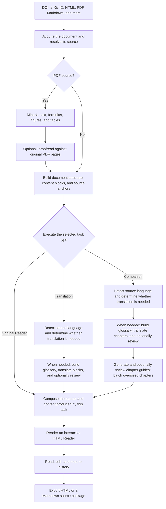

# Agentic Learning Copilot (ALC)

English | [简体中文](README.zh-CN.md)

ALC turns source documents (DOIs, arXiv IDs, HTML, PDF, Markdown, and more) into
translations, interactive HTML readers, and source-anchored learning companions.

## Install

ALC currently offers two ways to use it: Local Web and an agent plugin.

**Local Web** runs a document workspace on your computer. Configure models,
create translation or Companion tasks, and open or download Readers in a browser.

**Agent plugin** lets Codex, Claude Code, DeepSeek Harness, or shell/Python hosts such as
ChatGPT Work and dot run ALC workflows
from natural-language instructions.

Both entry points use the same Python workflow packages. Local Web can discover
Agent project history on the same computer; it does not take over those tasks.
Model settings remain separate, and the plugin does not start Local Web.

### Local Web

Requirements: Python 3.11+ and Git. Building the frontend from source also needs
Node.js 20.19+ in the 20.x line, or 22.12+, with npm. An installed Web package
includes its frontend and can run through `alc-web` without Node.js.

```bash
git clone https://github.com/tririver/alc.git
cd alc
python3 scripts/alc-web.py --runtime-setup
```

On Windows, replace `python3` with `python`. If you already have the source,
run only the last command from the ALC directory. Initial setup needs internet
access to build the frontend and prepare a private Python environment with pinned
Foundation dependencies. No separate Foundation clone or manual activation is needed.

### Agent plugin

Codex:

```bash
codex plugin marketplace add tririver/alc --ref main
codex plugin add alc@alc
```

Claude Code:

```text
/plugin marketplace add tririver/alc@main
/plugin install alc
```

DeepSeek Harness:

```bash
dsh plugin --profile alc add github:tririver/alc
```

## Usage

### Local Web

From the ALC directory, run this command to start the service and open the webpage:

```bash
python3 scripts/alc-web.py --project-dir local/reading-workspace
```

See the [Local Web guide](packages/alc-web/README.md) for task creation,
credentials, supported inputs, launch options, and development setup.

### Agent plugin

After installation, select ALC in your agent and send a document link or attach
a local file with your request. These are **chat instructions, not terminal commands**:

> Use @ALC to create a Simplified Chinese Companion for the attached document. Explain it for a beginner.

> Use @ALC to translate https://arxiv.org/html/2609.04315v1 into Simplified Chinese. Only translate, use 8 concurrent batches, skip content review, and deliver an HTML Reader.

You can specify these options in the same message:

| Option | What to say / behavior when omitted |
| --- | --- |
| Result | Translation, Companion, or original-only Reader. State the result you want. |
| Target language | For example, Simplified Chinese or English; specify it to avoid ambiguity. |
| Concurrency | 1–8 concurrent batches per task; default **2**. |
| Content review | **0** (none), **1** round, or **at most 2** rounds; default **1**. Applies to translation and Companion. |
| Model and effort | Specify an available model and supported effort. Codex's current default is `gpt-6-luna` / `medium`; Host inherits the host model and effort unless requested, and other providers resolve their own defaults. |
| Additional requirements | Terminology, writing style, intended audience, or output directory. |

Presets are shorthand: **fast draft = 4 / 0**, **standard = 2 / 1**, and
**strengthened review = 2 / 2** (concurrency / review rounds). Other combinations
are custom. More concurrency does not guarantee faster processing: hardware,
network and model-service limits also matter. Zero review skips model content
review but retains source/output validation; two rounds may finish early.
These settings concern translation and Companion.

The plugin prepares its runtime on demand using pinned Git revisions; no manual
repository clone is needed. See the [Skill guide](plugins/alc/skills/alc/SKILL.md)
for detailed workflows.

### Work and dot

ALC 2.2 supports portable Host execution. See the
[Host guide](plugins/alc/skills/alc/manuals/host-execution.md) for capability
checks, model inheritance, export/submit/resume and installation diagnostics.
Companion independent guide/reviewer stages require fresh subagent contexts.
The cloud plugin delivers standalone Readers; it does not start Local Web.
Native CLI routes and configured MinerU remain available. Host PDF recognition
is an optional alternative; see the [PDF guide](plugins/alc/skills/alc/manuals/host-pdf.md).
Offline protocol tests do not establish OCR accuracy or account-specific access.

Plugin installation and updates track `main` by default. For a reproducible
installation, ask the host to package a verified version tag instead. The
previous version is retained on `stable` during this release transition.
The optional packager remains available for manual use; CI does not produce
a distribution ZIP or publish a GitHub Release.

### PDF recognition and OCR proofreading

ALC uses **MinerU** to recognize PDF documents, preserving formulas, figures,
tables, and page mappings while retaining the original PDF and extraction evidence.

Processing flow:



See [Local Web PDF setup](packages/alc-web/README.md#pdf-ocr), [OCR proofreading contracts](packages/alc-ocr-proofread/README.md#native-pdf-source-bundles), and [local MinerU installation](packages/alc-ocr-proofread/README.md#opt-in-local-mineru-setup).

## Packages and architecture

| Package | Responsibility |
| --- | --- |
| [`alc-ocr-proofread`](packages/alc-ocr-proofread/README.md) | PDF-vision review of page-mapped OCR |
| [`alc-translate`](packages/alc-translate/README.md) | Language detection, glossary, translation and review |
| [`alc-render`](packages/alc-render/README.md) | Document composition and interactive HTML |
| [`alc-companion`](packages/alc-companion/README.md) | Source-anchored Companion builds and revisions |
| [`alc-catalog`](packages/alc-catalog/README.md) | Local project history discovery shared by Agent and Web |
| [`alc-web`](packages/alc-web/README.md) | Local HTTP application, task queue and Reader delivery |

[AC Foundation](https://github.com/tririver/ac-foundation) owns durable jobs,
model execution, neutral documents, and proposer-reviewer orchestration.
ALC does not depend on ARC; optional research can be coordinated by the Skill.

## Development

The frontend is in `apps/web`; the local server is in `packages/alc-web`.
See the [development setup](packages/alc-web/README.md#development) for explicit
Foundation overrides, frontend builds and an existing Python environment.

Run tests and build distributions from the repository root in a prepared environment:

```bash
python -m pytest --import-mode=importlib packages/*/tests tests
scripts/build-packages.sh
```

Build the frontend before packaging `alc-web`. Keep generated files and local
experiments under ignored `local/` paths. See [AGENTS.md](AGENTS.md) for repository
rules.

## Version tags

Prepare a version in a release PR from a clean worktree:

```bash
scripts/release-alc.sh VERSION
```

`VERSION` uses the `MAJOR.MINOR.PATCH` format. The release script coordinates
package and plugin versions. It updates the product source SHA and package list
together, excluding the optional Web application from the plugin runtime. Keep
an existing runtime lock matched to its pinned tree until the replacement source
commit exists. New Foundation APIs must be available in the pinned Foundation
commit before clean-checkout CI or release validation; a working-tree override
is only for local development. The preparation script creates local commits;
it does not create or push a tag.

Merge Foundation changes first. Set both runtime repositories to the canonical
`https://github.com/tririver/ac-foundation.git` and
`https://github.com/tririver/alc.git` URLs before a formal tag. The Foundation
pin must be a full SHA already merged into upstream `main`, and the generated
source manifest must refer to that same commit. The product pin must be an
ancestor of the tagged commit with an identical `packages/` tree. A subsequent
pin-only commit is supported. If squash merging changes commit identities,
refresh the pin to the final upstream source commit in a follow-up PR before
tagging; do not retain a development fork SHA that upstream does not contain.

After merging and passing CI, an explicitly authorized maintainer creates an
annotated `vMAJOR.MINOR.PATCH` tag on the verified upstream commit and pushes
that tag. Tag CI checks all package, plugin and frontend versions against the
tag and `VERSION`, verifies upstream `main` ancestry and runtime pins, then
runs the normal tests and package builds. A tag is ready for use only after
that CI run succeeds. Never move a published tag; issue a new version for a
correction. Development commits do not each require a version bump.

For a local preflight (with a full upstream Foundation clone checked out at
the locked SHA):

```bash
python scripts/check-release-tag.py --tag vMAJOR.MINOR.PATCH \
  --check-pins --foundation-root /path/to/ac-foundation
```

This workflow creates no GitHub Release, distributed plugin ZIP or PyPI
publication. Give users the tag URL so their host can package the plugin from
that fixed source. CI does not run the ZIP-based cold-plugin installation job.
Packaging unit tests may still create temporary archive fixtures, and the packager remains
available for manual use. Package builds and test fixtures are validation,
not release assets. Cold installation of a packaged plugin must be checked
separately when needed.

## License

MIT. See [LICENSE](LICENSE).
